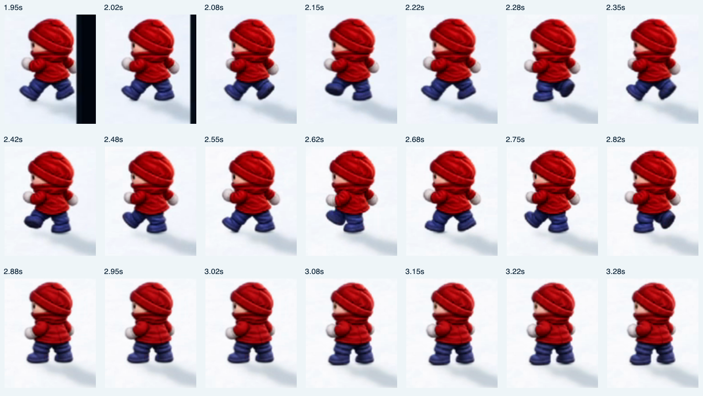
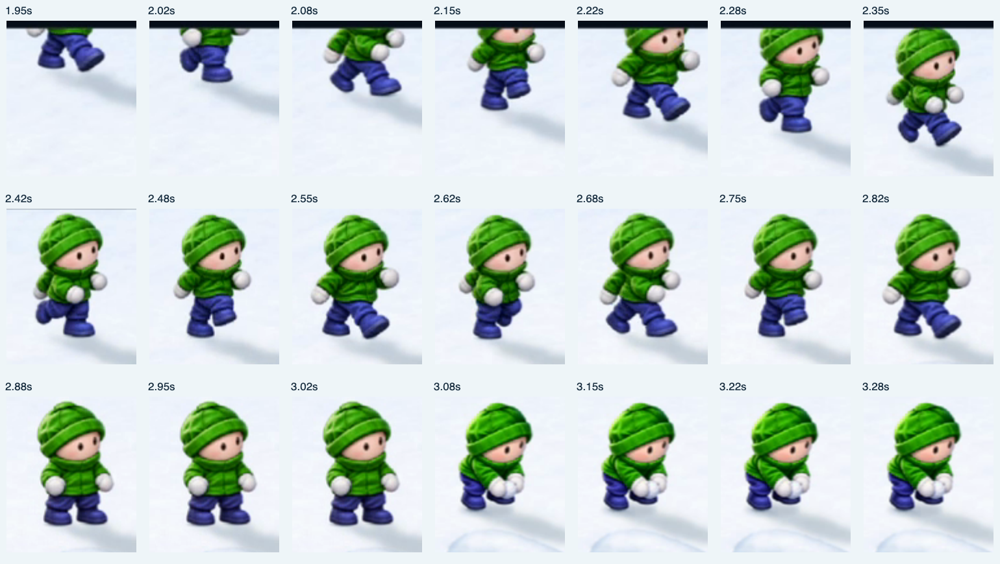

# Run-on animation review — November 10

Source: `/Users/rich/Desktop/2026-11-10_06-11-47.mp4` (4.773 seconds,
2056×1116, encoded at 120 fps). Reviewed the whole recording and extracted
30 fps detail from 1.65–3.45 seconds. The frame comparisons below stabilize
each character's cap to make pose progression easy to inspect.

The run-on is still unconvincing. Smooth translation has improved travel, but
the gait reads as skating or marching toy figures. I would not call it finished.

1. **Uneven alternating gait, especially Reds — 1.95–2.82 s.** Many frames repeat
   the same forward-leg silhouette. The opposing contact, passing and push-off
   poses do not form a clear sequence. Re-author one coherent alternating cycle
   with explicit left/right stance and swing; pose count alone has not solved it.
2. **Feet skate and the projected shadow dominates — throughout the entry.**
   Boot contact points are aligned to sprite pixels, but the planted boot still
   travels with the sprite. The darker contact is mostly hidden under the boot,
   while the broad shadow sits down/right, so figures still appear to hover.
   Lock the support foot in world space during stance and expose a tight contact
   edge below the sole. Lift it only during swing.
3. **Rigid upper bodies — about 2.0–2.8 s.** Heads and torsos hold nearly the
   same silhouette while the boots switch sharply. Add opposite arm swing,
   restrained hip/shoulder rotation and a small contact compression. Preserve
   proportions while allowing the body to act on the steps.
4. **Abrupt arrival — about 2.8–3.1 s.** The last stride changes abruptly into
   a different standing stance/head angle. The current final-segment easing and
   held settle pose are visually insufficient. Begin braking two or three steps
   earlier, finish on a supporting foot, and animate a short walk-to-ready settle
   within the existing arrival/activation schedule.
5. **Post-arrival movement needs a different gait — about 3.7–4.77 s.** The
   Greens' small backward moves reuse the high-knee entry motion and sharp pose
   switches. Author shorter backward and lateral steps rather than relying on
   reversing the forward cycle; scale stride amplitude with actual travel speed.
6. **Santa competes with the entrance — about 2.2–4.77 s.** His larger running
   silhouette draws the eye across the field while the teams are arriving. The
   requested stationary magical departure removes this distraction and gives him
   a distinct visual beat beside the Christmas grove.

Priority: correct the authored gait and stance-foot behavior first, then the
arrival transition, then secondary body motion. More interpolation of the same
poses will not address the core problem.

This review records recommendations. Player animation was not changed in this
follow-up; Santa's new nose-twitch/magical disappearance was implemented separately.
